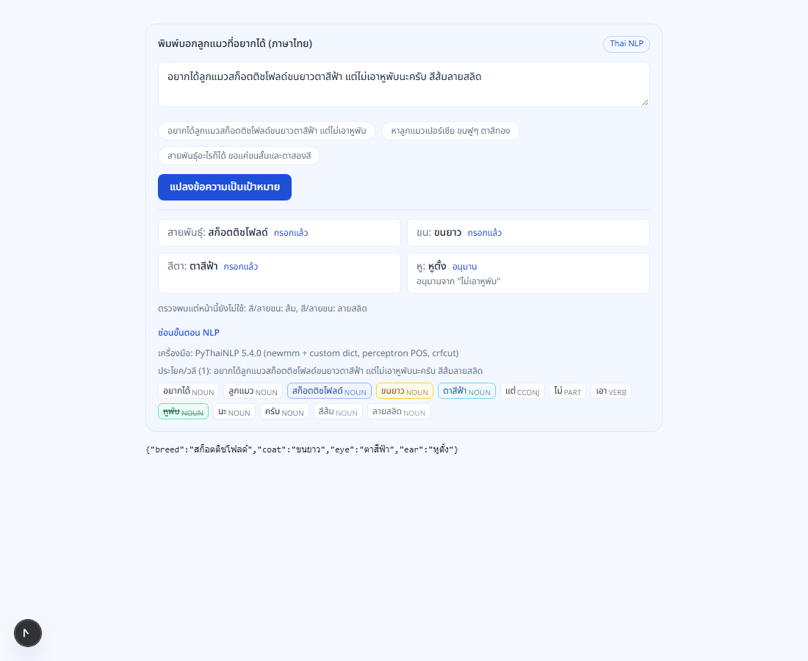

# NLP ภาษาไทยใน MeowMatch (Active Learning — NLP Tools)

## ฟีเจอร์ที่เพิ่ม

หน้า **แมวที่ต้องการ** มีช่อง **“พิมพ์บอกลูกแมวที่อยากได้ (ภาษาไทย)”**
ผู้ใช้พิมพ์ภาษาพูด แล้วระบบแปลงเป็นค่าในฟอร์มเป้าหมาย (สายพันธุ์ / ขน / สีตา / หู) ให้อัตโนมัติ

```text
"อยากได้ลูกแมวสก็อตติชโฟลด์ขนยาวตาสีฟ้า แต่ไม่เอาหูพับนะครับ"
  → สายพันธุ์ สก็อตติชโฟลด์ · ขน ขนยาว · สีตา ตาสีฟ้า · หู หูตั้ง (อนุมานจาก "ไม่เอาหูพับ")
```

ผู้ใช้ยังตรวจ/แก้ค่าได้ก่อนกด “วิเคราะห์ผลลัพธ์” ตามเดิม NLP ทำหน้าที่ **Input** เท่านั้น
ไม่เปลี่ยนกติกาการประเมินโอกาสของระบบ



## Pipeline

| ขั้น | ในแอป (builtin, ทำงานเสมอ) | เมื่อเปิด PyThaiNLP service |
|---|---|---|
| 1. Text normalization | ลบ zero-width, แก้สระอำ, ย่ออักษรซ้ำ (`ฟ้าาาา` → `ฟ้า`) | เหมือนกัน (ทำก่อนส่ง) |
| 2. Sentence segmentation | วรรคตอน / ช่องว่างระหว่างวลีไทย | `crfcut` |
| 3. Word segmentation | `Intl.Segmenter("th")` + พจนานุกรมโดเมน + maximal matching (แนว newmm) | `newmm` + `custom_dict` |
| 4. POS tagging | lexicon ของโดเมน (UD tags) | `perceptron` / `orchid_ud` |
| 5. Entity extraction (NER แบบ rule-based) | gazetteer n-gram + รูปแบบหัวคำ–ค่า (`ตา|เป็น|สี|ฟ้า`, `ขน|ต้อง|ยาว`) | ใช้ token จาก PyThaiNLP |
| 6. Negation scope | `ไม่/ไม่เอา/ห้าม/ยกเว้น` ก่อน entity ≤ 3 คำ ไม่ข้ามคำเชื่อม `แต่/และ/หรือ` | เหมือนกัน |
| 7. Slot resolution | หลายค่าขัดกัน → ให้ผู้ใช้เลือกเอง, ปฏิเสธค่าเดียวในตัวเลือก 2 ค่า → อนุมาน, `อะไรก็ได้` → ไม่จำกัด | เหมือนกัน |

ถ้า service ปิด หมดเวลา (3 วินาที) หรือ token ไม่ตรงกับข้อความ → ใช้ตัวตัดคำในแอปอัตโนมัติ

## ไฟล์

| ไฟล์ | หน้าที่ |
|---|---|
| `src/domain/nlp/lexicon.ts` | พจนานุกรมโดเมน: พันธุ์ 15 ชื่อ, ขน, สีตา, หู, สี/ลาย, คำปฏิเสธ |
| `src/domain/nlp/thai.ts` | normalize, แบ่งประโยค, ตัดคำ, POS |
| `src/domain/nlp/goal-parser.ts` | entity extraction, negation, slot resolution |
| `src/server/nlp/pythainlp.ts` | client เรียก PyThaiNLP service (zod ตรวจผล, timeout, fallback) |
| `src/server/nlp/goal-text-action.ts` | server action (ต้องล็อกอิน, จำกัด 300 ตัวอักษร) |
| `src/features/goals/goal-text-input.tsx` | UI ช่องพิมพ์ + แสดงขั้นตอน NLP (คำ/POS/entity) |
| `nlp-service/app.py` | FastAPI + PyThaiNLP |
| `nlp-service/experiment.py` | ทดลองเทียบเครื่องมือกับข้อมูลกรณีศึกษา |
| `src/domain/nlp/fixtures/case-study.json` | ข้อความกรณีศึกษา 15 ประโยค + คำตอบที่ถูก |

## ผลทดลอง (สรุป — ฉบับเต็ม [experiment-results.md](experiment-results.md))

Domain term recall = สัดส่วนคำโดเมน (เช่น `สก็อตติชโฟลด์`, `ขนยาว`, `ตาสีฟ้า`) ที่ถูกตัดออกมาเป็นคำเดียว

| ตัวตัดคำ | recall |
|---|---|
| PyThaiNLP newmm (พจนานุกรมปกติ) | 13/54 (24%) |
| PyThaiNLP newmm + custom dict | 46/54 (85%) |
| PyThaiNLP longest + custom dict | 45/54 (83%) |
| TLTK word_segment | 17/54 (31%) |
| ตัวตัดคำในแอป (Intl.Segmenter + dict)\* | 59/60 |

\* วัดใน vitest ด้วยวิธีเดียวกันแต่ชุดคำโดเมนต่างเล็กน้อย (นับคำจาก `DOMAIN_WORDS` และ normalize อักษรซ้ำ) จึงเทียบได้คร่าว ๆ เท่านั้น

ความถูกต้องของการแปลงเป็นเป้าหมาย: **15/15 ประโยคกรณีศึกษา ตรงทุกช่อง** ทั้งตัวตัดคำในแอป และเมื่อใช้ token จาก PyThaiNLP จริง

ข้อสังเกต:

- newmm ตัดชื่อพันธุ์/คำประสมผิด (`สก็อต|ติ|ชโฟลด์ขน`) → ต้องใช้ custom dictionary
- perceptron ให้ `ไม่` = PART/NEG ได้ถูก แต่คำประสมที่เพิ่มเข้า dict (`ขนยาว`) เป็นคำนอกคลังจึงได้ NOUN → ใช้พจนานุกรมโดเมนตัดสิน entity
- crfcut มักไม่แบ่งประโยคสั้นที่ไม่มีวรรคตอน → ใช้คำเชื่อมเป็นขอบเขตการปฏิเสธเพิ่ม

## ข้อจำกัด

- เป็น rule-based: คำ/สำนวนที่ไม่อยู่ในพจนานุกรมจะไม่ถูกจับ (ระบบแจ้งเตือนว่าไม่พบ)
- สี/ลายขนถูกตรวจพบแต่หน้านี้ยังไม่ใช้เป็นเป้าหมาย (แสดงว่า “ตรวจพบแต่ยังไม่ใช้”)
- ยังไม่ได้ทดสอบ authenticated E2E บนเว็บจริง เพราะ Supabase project ของแอปติดต่อไม่ได้ขณะทดสอบ (DNS ไม่ resolve)
  — ตรวจ UI ผ่านหน้าพรีวิวชั่วคราว + Testing Library แทน
